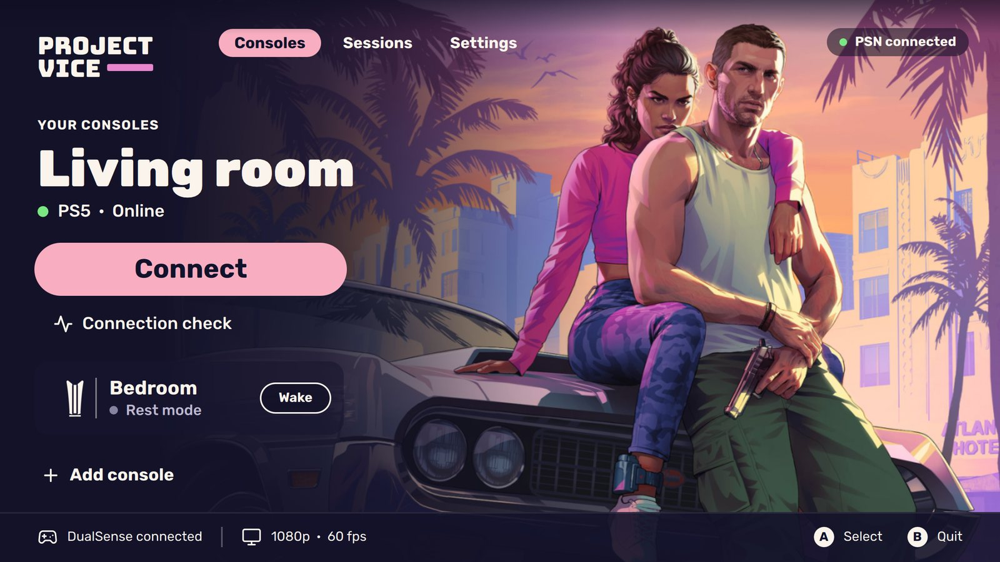
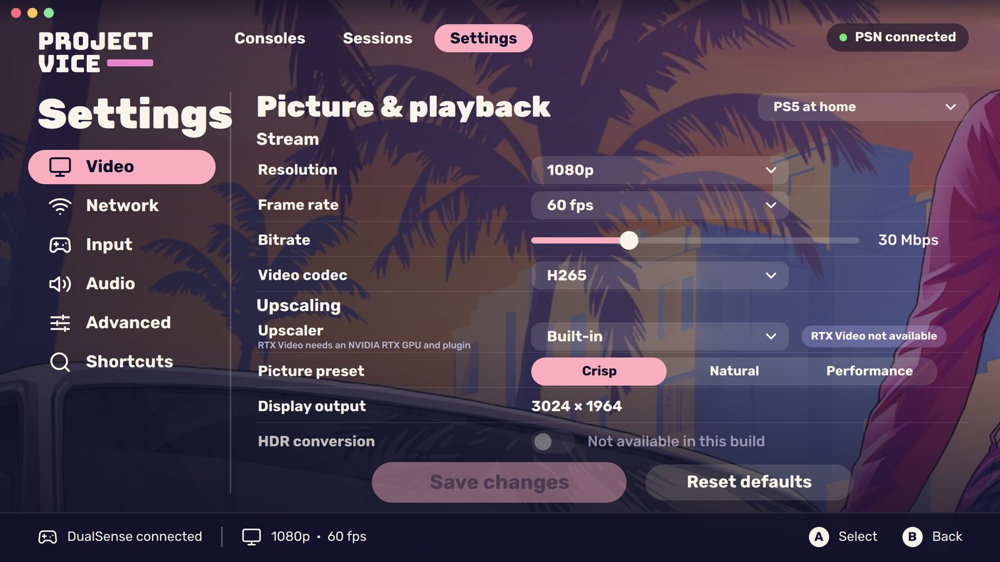

# Project Vice

Project Vice is a free, open-source Remote Play client for PC. Your console runs the game; Project Vice streams it to a Windows, macOS or Linux computer or a Steam Deck, with a controller-first interface built for the couch.

## Install

**Windows 10 and 11 (64-bit).** Download `ProjectVice-Setup-<version>.exe` from this repository's [Releases](../../releases) and run it. It installs for your user account, needs no administrator rights, and adds a Start menu entry. Windows may warn that the installer is unsigned: choose "More info", then "Run anyway".

**macOS 26 or newer, Apple silicon.** Download `ProjectVice-<version>-arm64.dmg` from [Releases](../../releases), open it and drag Project Vice onto Applications. The app is not notarized by Apple, so macOS blocks the first launch: open System Settings, Privacy & Security, scroll to the message about Project Vice and choose "Open Anyway". Everything it needs is inside the app, including MoltenVK.

**Linux and Steam Deck.** Build from source; the steps are in [`VICE.md`](VICE.md).

Already using chiaki-ng? Its paired consoles and settings can be carried over; see "Moving from chiaki-ng" in [`VICE.md`](VICE.md).

## What it does

**Consoles**
- Finds the PS4 and PS5 consoles on your network, pairs with the 8-digit code, wakes a console from rest mode and connects.
- Adds a console by address for one on another network, and hides or removes consoles.
- Play away from home through your PSN account or with port forwarding, with a step-by-step guide in the app.

**Before you play**
- A connection check: 30 seconds of ping, jitter and packet loss, with the Wi-Fi band and signal your computer reports.
- Game mode (least delay) or Quality mode (sharper scaling), remembered per game profile.
- A connecting screen with the tips you will want once the picture is up.

**While you play**
- A quick menu on one compact panel: mode, upscaler, bitrate, volume, microphone, picture size (fit, zoom, stretch), the stats overlay and its size, save the last 30 seconds, resume, disconnect.
- A stats overlay in three sizes, from everything (frame rate, bitrate, ping, loss, decode, render, client delay, input delay, dropped frames, network pauses) down to frame rate and ping. It shows the game's own frame rate beside the stream's: a game drawing 30 pictures a second in a 60 fps stream reads "60 fps, Game 30 fps".
- Replay: keep the last 30 seconds in memory and save them as an MP4.
- Adaptive bitrate that steps down when the connection cannot carry the stream.
- Notices over the game for an unstable connection, a controller that disconnects and a network that keeps pausing.
- The mouse pointer stays out of the way and comes back when you move the mouse.

**Controllers**
- Works with a controller, a keyboard or a mouse; every screen can be driven with the D-pad.
- Names the controller that is connected, and shows PlayStation or Xbox button labels to match.
- A controller with no touchpad gets one: the View button sends the touchpad click (View with Menu sends Create).
- Button mapping per controller; stick deadzones and response curve per game profile.
- DualSense haptics and adaptive triggers over USB; rumble on other controllers.
- On a Steam Deck: the Steam Input layout is set up for you, and the app can add itself to your Steam library.

**Performance**
- Hardware video decoding, drawn with Vulkan (OpenGL as a fallback).
- On Windows with an NVIDIA RTX card: RTX Video Super Resolution as the upscaler, through the graphics driver, with no NVIDIA software shipped. Sharper than the built-in scalers, for about 7 ms more delay. Turn on "RTX Video Enhancement: Super Resolution" in the NVIDIA app first.
- Low-delay decoding, raised priority for the stream's threads and priority marking on stream packets.
- On Windows, for the length of a session: 1 ms timers and Wi-Fi streaming mode with background scanning off.
- A benchmark that plays two measured sessions, tuning off then on, and shows both.

**The rest**
- Settings for video, network, input, audio and advanced options, with every upstream option still reachable under "All settings".
- Session history kept on your computer: duration, bitrate, packet loss, dropped frames.
- A window without a system title bar, full screen with F11, and one window at a time.

More screens are in [`screenshots/`](screenshots/).

| | |
| --- | --- |
|  |  |
|  |  |

## Not available yet

- **RTX Video HDR conversion.** Turning a normal picture into HDR with an NVIDIA card is not built; the app lists it as unavailable. HDR from the console itself is available: choose "H265 with HDR" as the codec, with an HDR display and HDR turned on in the system.
- **Reading a third-party controller's own touchpad or back paddles on Windows.** In PC (XInput) mode the controller does not report them. Use the controller's PlayStation mode if it has one.

## Status

Early. Built and played on macOS, on a Steam Deck and on Windows 11; built on Linux. The macOS disk image has been started on the Mac that built it and not yet on another one. The Windows build has been played on a PS5 over Wi-Fi with an NVIDIA GPU. Not yet tried with a controller in hand on Windows: the second step of button mapping and the automatic touchpad assignment. [`VICE.md`](VICE.md) has the details, the build steps and how the code is laid out.

## Use your own console

Project Vice works with consoles you own and your own PSN account. It is not affiliated with or endorsed by Sony Interactive Entertainment, Rockstar Games or Take-Two Interactive. PlayStation, PS4 and PS5 are trademarks of Sony Interactive Entertainment. The background artwork is described in [`gui/src/qml/vice/artwork/SOURCE.md`](gui/src/qml/vice/artwork/SOURCE.md).

## Licence and credits

AGPL-3.0-only with an OpenSSL exception; see [`COPYING`](COPYING) and [`LICENSES/`](LICENSES/). Project Vice is built on the Remote Play protocol work of the Chiaki and chiaki-ng projects, whose copyright notices are kept throughout the source.
