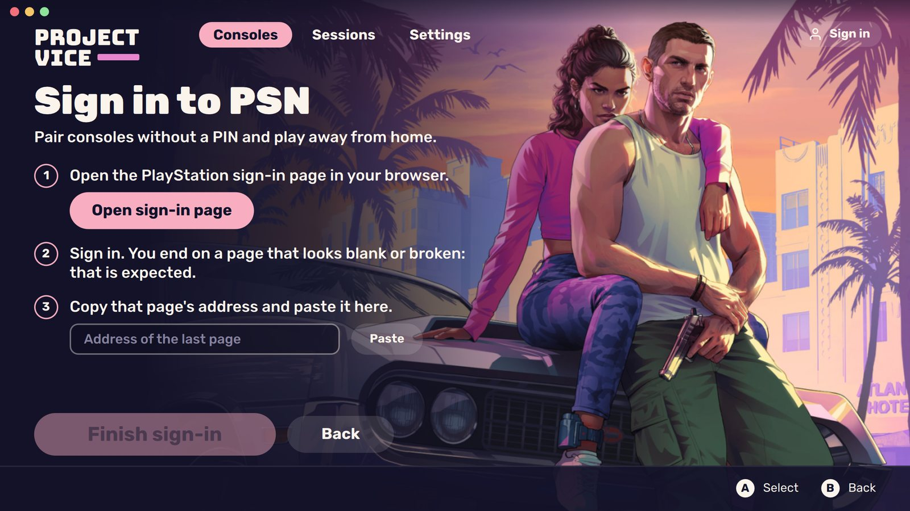
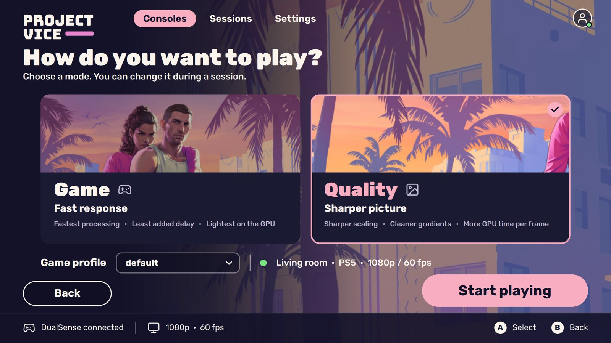

# Project Vice

Project Vice is a free, open-source Remote Play client. Your PS5 or PS4 runs the game; Project Vice streams it to a Windows PC, a Mac or a Steam Deck, at home or away from home, with a controller-first interface built for the couch.

**On this page:** [Download](#download) · [What you need](#what-you-need) · [Set up, step by step](#set-up-step-by-step) · [Play away from home](#play-away-from-home) · [Steam Deck](#steam-deck) · [Shortcuts](#shortcuts) · [What it does](#what-it-does) · [If something goes wrong](#if-something-goes-wrong) · [Build it yourself](#build-it-yourself)

## Download

Every build is on the [Releases](../../releases) page. Pick the file for your device:

| Your device | File to download |
| --- | --- |
| Windows 10 or 11, 64-bit | `ProjectVice-Setup-<version>.exe` |
| Mac with Apple silicon (M1 or newer), macOS 26 or newer | `ProjectVice-<version>-arm64.dmg` |
| Steam Deck, or a 64-bit Intel or AMD Linux PC | `ProjectVice-<version>-x86_64.AppImage` |

While this repository is private, the Releases page answers "404, not found" unless you are signed in to GitHub with an account that has access to it.

There is no build for Intel Macs. Already using chiaki-ng? Its paired consoles and settings can be carried over; see "Moving from chiaki-ng" in [`VICE.md`](VICE.md).

## What you need

- A PS5, or a PS4 on system software 8.0 or later, that you own.
- Your PlayStation Network account: the one signed in on that console.
- A controller. A DualSense or DualShock 4 gives you everything, the touchpad included; an Xbox or other controller works too, and so do the Steam Deck's own controls. A keyboard is enough for the menus.
- A good connection between the two. Put the console on a network cable if you can. For the computer, use a cable or 5 GHz Wi-Fi; 2.4 GHz Wi-Fi stutters. Away from home, the upload speed of your home internet matters most: 10 Mbps or more is comfortable.

## Set up, step by step

Do these once, at home, with the computer and the console on the same network.

### Step 1: Install Project Vice

**Windows**

1. Download `ProjectVice-Setup-<version>.exe` and run it.
2. Windows says the installer is from an unknown publisher, because it is not signed. Choose "More info", then "Run anyway".
3. Follow the installer. It installs for your user account only, needs no administrator rights and adds a Start menu entry.
4. Open Project Vice from the Start menu.

**Mac**

1. Download `ProjectVice-<version>-arm64.dmg` and open it.
2. Drag Project Vice onto the Applications folder shown beside it.
3. Open Project Vice from Applications. macOS blocks this first launch, because the app is not notarized by Apple. Choose "Done".
4. Open System Settings, go to Privacy & Security, scroll down to the message about Project Vice and choose "Open Anyway". Confirm once more. From then on it opens normally.

Everything the app needs is inside it; there is nothing else to install.

**Steam Deck**

See [Steam Deck](#steam-deck) below: the install has a few steps of its own.

**Linux PC**

1. Download `ProjectVice-<version>-x86_64.AppImage`.
2. Make it runnable: `chmod +x ProjectVice-*.AppImage`.
3. Run it: `./ProjectVice-*.AppImage`.

### Step 2: Get the console ready

**On a PS5**

1. Go to Settings, System, Remote Play and turn on "Enable Remote Play".
2. Go to Settings, System, Power Saving, Features Available in Rest Mode. Turn on "Stay Connected to the Internet" and "Enable Turning On PS5 from Network". This is what lets Project Vice wake the console when it is in rest mode.

**On a PS4**

1. Go to Settings, Remote Play Connection Settings and turn on "Enable Remote Play".
2. Go to Settings, Account Management, Activate as Your Primary PS4 and choose "Activate".
3. Go to Settings, Power Save Settings, Set Features Available in Rest Mode. Turn on "Stay Connected to the Internet" and "Enable Turning On PS4 from Network".

When you finish playing on the console itself, put it in rest mode instead of turning it off. A console that is fully off cannot be woken over the network.

### Step 3: Sign in to PlayStation Network

Pairing needs your PSN account ID, and signing in reads it for you. Signing in is also what makes playing away from home work without touching your router.

1. In Project Vice, choose the account button at the top right of the Home screen.
2. On Windows, the PlayStation sign-in page opens inside the app. Sign in and you are done.
3. On a Mac, a Steam Deck or a Linux PC, choose "Open sign-in page". Your browser opens the PlayStation sign-in page. Sign in. You end on a page that looks blank or broken: that is expected. Copy that page's address from the browser's address bar, go back to Project Vice and paste it into "Address of the last page".

Your password is typed into PlayStation's own page and never into Project Vice. If you would rather not sign in, choose "Find your account ID" and enter your PSN username instead; this is enough for pairing and for playing at home, but not for playing away from home through PSN.

### Step 4: Pair the console

1. Project Vice finds the consoles on your network and shows them on the Home screen. Pick yours and choose "Pair console".
2. On the console, ask for a pairing code. On a PS5: Settings, System, Remote Play, Link Device. On a PS4: Settings, Remote Play Connection Settings, Add Device. The console shows an 8-digit code.
3. Enter the 8 digits in Project Vice. The code lasts a few minutes; if it is refused, get a new one on the console.
4. If your console asks for a login PIN when it starts, enter that PIN in the optional field as well.

The console now shows "Connect" on the Home screen. Pairing is done once per computer.

If your console is not listed, choose "Add console" and pick it from what was found, or type its address.

### Step 5: Play

1. Choose "Connect". A console in rest mode is woken first, which takes a little while.
2. Pick how you want to play: **Game** for the least delay, or **Quality** for a sharper picture. You can change this during a session.
3. The stream starts. Play.
4. To change something or stop, open the quick menu: press L1, R1, L3 and R3 together, press Ctrl+O, or click the tab at the top right of the picture. From there you can change the bitrate, the picture size and the volume, show the stats overlay, and disconnect.

Before your first session, "Connection check" on the Home screen measures ping, jitter and packet loss to the console for 30 seconds and tells you what your network can carry.

| | |
| --- | --- |
|  |  |

## Play away from home

Once the steps above are done, the same console can be reached from a hotel, an office or a friend's house. This works the same way on Windows, on a Mac and on a Steam Deck. There are two ways to do it. Try the first; use the second only if the first does not connect.

**Before you leave home**

- Pair the console at home (steps 1 to 4 above) and play once to confirm it works.
- Leave the console in rest mode, with the two rest mode settings from step 2 turned on.
- Sign in to PSN in Project Vice (step 3).

### Way 1: Through PSN (easiest)

No router changes. PlayStation Network introduces your computer and your console to each other, then they connect directly. It works on most networks.

1. Away from home, open Project Vice. Consoles on your account show on the Home screen as "Away, through PSN".
2. Choose "Connect".
3. If your console is missing, open Settings, Network, "Play from anywhere" and choose "Refresh my consoles". If Project Vice says your sign-in has expired, sign in again.

### Way 2: Port forwarding

Use this if connecting through PSN fails, which happens on some strict networks. You set it up once in your home router.

1. In your router, give the console a fixed address (often called a DHCP reservation or static lease), so the rules below keep pointing at it.
2. In your router, forward these ports to the console's address:

   | Console | Ports |
   | --- | --- |
   | PS5 | 9295 (TCP and UDP), 9296 (UDP), 9297 (UDP), 9302 (UDP) |
   | PS4 | 987 (UDP), 9295 (TCP and UDP), 9296 (UDP), 9297 (UDP) |

3. Note your home's public address: at home, search the web for "what is my IP".
4. Away from home, choose "Add console" in Project Vice, then "Enter an address instead", and type your home's public address. Then connect.

Things to know about this way:

- It is IPv4 only.
- If your internet provider puts you behind a shared address (CGNAT), forwarding cannot work. Use PSN instead.
- Most home connections get a new public address from time to time. If the console stops being found, check the address again.

The app has the same guide with the buttons beside each step: Settings, Network, "Play from anywhere".

### Picture quality away from home

A connection over the internet carries less than your home network. In Settings, Video, find "Away-from-home starting point" and choose "Use it": 720p, 60 fps and 8 Mbps, which holds up on most connections. Raise the bitrate from the quick menu if the connection keeps up. In Game mode, Project Vice lowers the bitrate on its own when packets are being lost.

## Steam Deck

**Install**

1. Press the Steam button, choose Power, then "Switch to Desktop".
2. In the browser, download `ProjectVice-<version>-x86_64.AppImage` from Releases. Move it somewhere it can stay, for example a folder named `Applications` in your home folder.
3. Make it runnable: right-click the file, choose Properties, Permissions, and tick "Is executable".
4. Double-click it to open Project Vice.

**Set up, still in Desktop mode**

5. Do steps 2 to 4 above: get the console ready, sign in to PSN and pair. Signing in opens the browser, which is why this is done in Desktop mode. To type, press Steam and X for the on-screen keyboard.

**Add it to Steam**

6. On the Home screen of Project Vice, press L3 (or F1 on a keyboard) to add it to your Steam library. The entry comes with artwork and a controller layout made for PlayStation games.
7. Close Project Vice and choose "Return to Gaming Mode" on the desktop.
8. In Gaming Mode, open your Library, go to the Non-Steam tab and start Project Vice.

The controller layout is applied after Steam restarts, so restart the Deck once if the buttons do not match. Settings, Input, "Steam Deck layout" switches between the PlayStation layout and Steam's plain gamepad layout.

Playing away from home on a Deck is the same as above. Sign in to PSN in Desktop mode before you leave.

## Shortcuts

The app lists these in Settings, Shortcuts.

| Where | What | Keyboard | Controller |
| --- | --- | --- | --- |
| Anywhere | Full screen | F11 | |
| Anywhere | Quit (Windows and Linux) | Ctrl+Q | |
| Menus | Move | Arrow keys | D-pad |
| Menus | Select, go back | Enter, Esc | Cross, Circle (A, B) |
| Menus | Consoles, Sessions, Settings | Page Up, Page Down | L1, R1 |
| Menus | Add a console | F2 | R3 |
| Menus | Add to Steam | F1 | L3 |
| During play | Quick menu | Ctrl+O | L1 + R1 + L3 + R3 |
| During play | Microphone on or off | Ctrl+M | |
| During play | Zoom the picture | Ctrl+Z | |
| During play | Stretch the picture | Ctrl+S | |

## What it does

**Consoles**
- Finds the PS4 and PS5 consoles on your network, pairs with the 8-digit code, wakes a console from rest mode and connects.
- Adds a console by address for one on another network, and hides or removes consoles.
- Play away from home through your PSN account or with port forwarding, with a step-by-step guide in the app.

**Before you play**
- A connection check: 30 seconds of ping, jitter and packet loss, with the Wi-Fi band and signal your computer reports.
- Game mode (least delay) or Quality mode (sharper scaling), remembered per game profile.
- A connecting screen with the tips you will want once the picture is up.

**While you play**
- A quick menu on one compact panel: mode, upscaler, bitrate, volume, microphone, picture size (fit, zoom, stretch), the stats overlay and its size, save the last 30 seconds, resume, disconnect.
- A stats overlay in three sizes, from everything (frame rate, bitrate, ping, loss, decode, render, client delay, input delay, dropped frames, network pauses) down to frame rate and ping. It shows the game's own frame rate beside the stream's: a game drawing 30 pictures a second in a 60 fps stream reads "60 fps, Game 30 fps".
- Replay: keep the last 30 seconds in memory and save them as an MP4.
- Adaptive bitrate that steps down when the connection cannot carry the stream.
- Notices over the game for an unstable connection, a controller that disconnects and a network that keeps pausing.
- The mouse pointer stays out of the way and comes back when you move the mouse.

**Controllers**
- Works with a controller, a keyboard or a mouse; every screen can be driven with the D-pad.
- Names the controller that is connected, and shows PlayStation or Xbox button labels to match.
- A controller with no touchpad gets one: the View button sends the touchpad click (View with Menu sends Create).
- Button mapping per controller; stick deadzones and response curve per game profile.
- DualSense haptics and adaptive triggers over USB; rumble on other controllers.
- On a Steam Deck: the Steam Input layout is set up for you, and the app can add itself to your Steam library.

**Performance**
- Hardware video decoding, drawn with Vulkan (OpenGL as a fallback).
- On Windows with an NVIDIA RTX card: RTX Video Super Resolution as the upscaler, through the graphics driver, with no NVIDIA software shipped. Sharper than the built-in scalers, for about 7 ms more delay. Turn on "RTX Video Enhancement: Super Resolution" in the NVIDIA app first.
- Low-delay decoding, raised priority for the stream's threads and priority marking on stream packets.
- On Windows, for the length of a session: 1 ms timers and Wi-Fi streaming mode with background scanning off.
- A benchmark that plays two measured sessions, tuning off then on, and shows both.

**The rest**
- Settings for video, network, input, audio and advanced options, with every upstream option still reachable under "All settings".
- Session history kept on your computer: duration, bitrate, packet loss, dropped frames.
- A window without a system title bar, full screen with F11, and one window at a time.

More screens are in [`screenshots/`](screenshots/).

## If something goes wrong

| What you see | What to do |
| --- | --- |
| The Releases page says 404 | Sign in to GitHub with an account that has access to this repository. |
| Windows: "Windows protected your PC" | Choose "More info", then "Run anyway". The installer is not signed. |
| Mac: "Apple could not verify Project Vice" | System Settings, Privacy & Security, "Open Anyway". The app is not notarized. |
| No console on the Home screen | Check the console is on or in rest mode and on the same network as the computer. Guest Wi-Fi networks usually keep devices apart. Otherwise choose "Add console", then "Enter an address instead". |
| The pairing code is refused | Codes last a few minutes: get a new one on the console. Check that the PSN account in Project Vice is the one signed in on the console. |
| The console does not wake | Turn on both rest mode settings from step 2, and leave the console in rest mode, not off. |
| The picture stutters or freezes briefly | Run "Connection check". Use a cable or 5 GHz Wi-Fi, lower the bitrate in the quick menu, and move closer to the router. The stats overlay counts network pauses: if "Pauses" rises with each stutter, the network is the cause. |
| A Mac on Wi-Fi stutters about twice a second | A Mac's Wi-Fi can leave the router's channel briefly for AirDrop and AirPlay discovery. A network cable avoids it; setting the router's 5 GHz channel to 44 or 149 often does too. |
| Away from home, the console does not connect through PSN | Open Settings, Network, "Play from anywhere", choose "Refresh my consoles", and sign in again if asked. If it still fails, set up port forwarding. |
| Buttons are wrong on a Steam Deck | Restart the Deck once after adding Project Vice to Steam, or change "Steam Deck layout" in Settings, Input. |

## Not available yet

- **RTX Video HDR conversion.** Turning a normal picture into HDR with an NVIDIA card is not built; the app lists it as unavailable. HDR from the console itself is available: choose "H265 with HDR" as the codec, with an HDR display and HDR turned on in the system.
- **Reading a third-party controller's own touchpad or back paddles on Windows.** In PC (XInput) mode the controller does not report them. Use the controller's PlayStation mode if it has one.
- **Signed installers.** The Windows installer is not signed and the Mac app is not notarized, so both systems ask before the first run.

## Status

Early, and every build on the Releases page is a preview.

- **Windows:** built and played on Windows 11 with an NVIDIA GPU and a PS5 over Wi-Fi. Not yet tried with a controller in hand: the second step of button mapping and the automatic touchpad assignment.
- **Mac:** built and played on an Apple silicon Mac. The disk image has been started on the Mac that built it and not yet on another one.
- **Steam Deck:** an earlier build was installed and played on a Steam Deck (SteamOS 3.9). The AppImage on the Releases page was built in a container, where it starts as far as setting up the renderer; it has not been run on a Deck yet.
- **Away from home:** both ways use the upstream project's connection code. Neither has been tried from outside the home network with this build.

[`VICE.md`](VICE.md) has the details, what was measured and how the code is laid out.

## Build it yourself

Each platform has one command, described in full under "Building" in [`VICE.md`](VICE.md):

| Platform | Command | Result |
| --- | --- | --- |
| Windows (MSYS2 MINGW64 shell) | `scripts/build-windows-msys2.sh`, then `ISCC scripts\project-vice.iss` | `dist\ProjectVice-Setup-<version>.exe` |
| macOS (Homebrew) | `scripts/build-macos-dmg.sh` | `dist/ProjectVice-<version>-arm64.dmg` |
| Steam Deck and Linux (Docker or Podman, on any machine) | `scripts/build-appimage-docker.sh` | `dist/ProjectVice-<version>-x86_64.AppImage` |

Nothing is built on GitHub. Builds are made on a developer's machine and attached to Releases.

## Use your own console

Project Vice works with consoles you own and your own PSN account. It is not affiliated with or endorsed by Sony Interactive Entertainment, Rockstar Games or Take-Two Interactive. PlayStation, PS4 and PS5 are trademarks of Sony Interactive Entertainment. The background artwork is described in [`gui/src/qml/vice/artwork/SOURCE.md`](gui/src/qml/vice/artwork/SOURCE.md).

## Licence and credits

AGPL-3.0-only with an OpenSSL exception; see [`COPYING`](COPYING) and [`LICENSES/`](LICENSES/). Project Vice is built on the Remote Play protocol work of the Chiaki and chiaki-ng projects, whose copyright notices are kept throughout the source.
